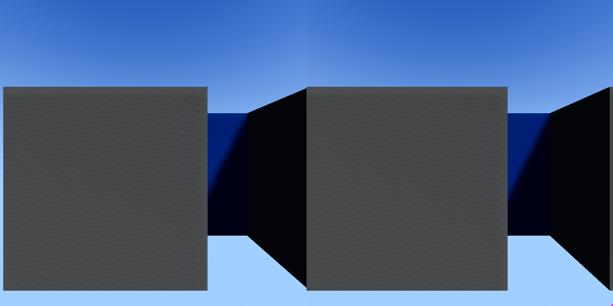

# WebXR on the Bevy web renderer

Status: exploration (OSO-7951). Spike branch:
[`spike/oso-7951-webxr`](https://github.com/ravenac95/officexr/tree/spike/oso-7951-webxr),
throwaway, not for merge.

## Recommendation

**Go, gated on one on-device check.** A WebXR session can drive Bevy
0.20 through the **WebGL2** build without forking Bevy or wgpu and without
a community crate. The spike draws the room as a stereo pair in an
emulated Quest 3 session (Meta's IWER), with Bevy updating once per
`XRSession.requestAnimationFrame` callback. Nothing has run on a real
headset yet. The open risks are frame rate on a Quest-class GPU and the
final copy into the real `XRWebGLLayer` framebuffer. Run the spike
on a headset (sub-issue 1) before doing anything else. If it can't hold
the headset's refresh rate with the room scene, stop and revisit when
WebXR/WebGPU binding ships.

## What VR was before

The three.js app had "Enter VR": `@react-three/xr`, `immersive-vr`, no
controllers or hands, with the headset steering the player. OSO-7954
removed it, and the room view then moved to Bevy (#36).

## Findings

### 1. Can a WebXR session drive Bevy's render target and per-eye cameras?

Yes on WebGL2. Not on WebGPU yet.

- **WebGPU.** The WebXR/WebGPU binding (`XRGPUBinding`) is an Immersive
  Web editor's draft. Chrome still has it only behind flags
  (`#webxr-projection-layers`, `#webxr-webgpu-binding`). wgpu's
  browser-WebGPU backend also has no way to adopt an outside
  `GPUTexture`: `create_texture_from_hal` is `wgpu_core`-only. So XR
  needs the WebGL2 build. `@officexr/render-wasm`'s `pickBackend`
  chooses WebGPU whenever an adapter exists, and Bevy boots once per
  page. An XR page must therefore load the webgl2 build from the start,
  for example by reloading with an `xr` flag when the user picks
  "Enter VR".
- **WebGL2, route A: canvas blit (the spike).** Bevy draws both eyes
  side by side into its primary-window canvas, using two cameras with
  viewports. Inside the XR frame callback, JS blits that canvas's default
  framebuffer into `XRWebGLLayer.framebuffer` on the same GL context.
  `canvas.getContext('webgl2')` returns the context wgpu already created,
  and `makeXRCompatible()` is called on it. The spike checked that the
  canvas holds the finished frame inside the XR callback. It could not
  test the blit itself, because IWER's layer framebuffer is `null` (the
  canvas is the XR surface). Costs: one full-size copy per frame, and
  the canvas (Bevy's window) must be resized to the layer's framebuffer
  size for the session.
- **WebGL2, route B: zero-copy (not tried).** wgpu-hal's GLES backend
  already has `TextureInner::ExternalFramebuffer { inner: WebGlFramebuffer }`,
  a web-only variant for rendering into an outside framebuffer. All of `wgpu_hal::gles::Texture`'s fields are public,
  so one could wrap the layer's framebuffer with
  `Device::create_texture_from_hal::<Gles>` and hand it to Bevy as a
  `ManualTextureView` (camera target `RenderTarget::TextureView`). The
  catches:
  - wgpu's GL backend renders Y-flipped and only un-flips in its
    surface-present blit, so the image would land upside down unless the
    projection flips Y (which also flips triangle winding).
  - It supports only a single colour attachment. That is fine for Bevy's
    final upscaling pass.
  - The opaque framebuffer is only complete inside the XR callback.

  Worth trying once route A works on a device, to remove the copy.

### 2. What Bevy needs

- **Per-eye cameras.** Two `Camera3d`s, children of the view entity so
  they inherit its `RenderLayers` through `Propagate`:
  - **Viewport:** `XRWebGLLayer.getViewport(view)`, with Y flipped
    (WebGL counts from the bottom, Bevy from the top).
  - **Transform:** `origin × XRView.transform.matrix`, where the origin
    is the player's feet and yaw.
  - **Projection:** `Projection::custom(XrProjection)`.
    `XRView.projectionMatrix` is a GL matrix with −1..1 depth, while
    Bevy wants reverse-Z infinite. The spike keeps the GL matrix's x/y
    scale and offset terms (`m[0]`, `m[5]`, `m[8]`, `m[9]`) and puts a
    near plane in Bevy's slot. The spike hard-codes 0.05; real code
    should use `session.renderState.depthNear`. Culling builds its
    frustum from that clip matrix. `get_frustum_corners`, which only
    shadow cascades use, is derived from the same terms. Headset eyes
    are asymmetric and IWER's eyes are symmetric, so the spike can't
    test those corners: sub-issue 3 needs a unit test with an
    asymmetric projection.
  - **Clear:** the second eye uses `ClearColorConfig::None`, because
    cameras on one window share its main texture.
  - **Sky:** the view's own camera goes inactive for the session. Its
    sky dome is that camera's child, so the dome stays where it was. For
    real use the sky should follow whichever camera is active.
- **Frame pacing (the main surprise).** bevy_winit on the web runs an
  update only after a window `RedrawRequested`, which comes from window
  rAF (the `ran_update_since_last_redraw` gate in `bevy_winit::state`).
  Headset browsers pause window rAF during an immersive session, so Bevy
  would stall. The spike gets around this with public API only:
  - While in XR, it sets every `Window.visible = false`. That is a no-op
    for winit's web canvas, but an all-invisible app skips the gate.
  - It switches `WinitSettings` to `Reactive { react_to_user_events }`,
    so window rAF no longer causes updates.
  - Each XR callback stores the views and sends
    `WinitUserEvent::WakeUp` through the `EventLoopProxy`. winit runs a
    proxy wake-up in a microtask, so Bevy's update and render finish
    before the XR frame ends. JS queues its blit as a later microtask.

  Measured: from the third XR frame on, exactly one Bevy update ran
  inside each XR callback. The first two frames run before the
  visibility flag takes effect.

  This leans on bevy_winit and winit internals: the gate, and microtask
  delivery for proxy events. A sturdier fix is a small upstream
  bevy_winit hook ("update now"), or a custom runner that owns the
  window handles. The microtask timing also holds only while winit's
  runner is idle and attached; otherwise the wake-up is queued for
  later.
- **Controls.** A head pose has to drive the player: yaw from the
  headset, the XR origin at the player's feet. That goes through
  `officexr-controls`' follow target and camera yaw. There is no
  controller or hand input, which matches the old three.js mode.

### 3. Cost

- **Wasm size:** no new crates. WebXR is called from JS, so no `web-sys`
  XR features are needed. The Rust side is about 250 lines (cameras,
  projection, pacing) and the JS side about 80 (session, frame loop,
  blit). The size delta was not measured. With no new dependencies it
  should be small. The webgl2 build already ships next to the WebGPU
  one (`packages/render-wasm/build.mjs` builds both), so XR adds no new
  artifact.
- **Complexity:** moderate and mostly contained in
  `officexr-render-web` plus one camera module. The frame-pacing
  workaround is the fragile part.
- **Runtime:** the unknown that matters. Bevy draws the scene once per
  eye (no multiview), and directional-light shadow cascades are per
  view, so shadow work doubles too. On a Quest 3 each eye is roughly
  1680×1760 at 72–90 Hz on WebGL2, plus route A's copy. Expect to cut
  shadow map size, MSAA or the framebuffer scale for XR.

### 4. Community crates

None is usable on wasm:

- **bevy_mod_xr / bevy_mod_openxr** (successors to bevy_oxr): OpenXR only.
  WebXR is listed as future work, and `bevy_mod_openxr` doesn't build for
  wasm.
- **bevy_mod_webxr:** one release (July 2024), for Bevy 0.14, and
  self-described as "not yet in a working state".
- **bevy_oxr:** deprecated in favour of the two crates above.

Their camera and `ManualTextureView` approach is what route B would
copy.

## Spike

[`spike/oso-7951-webxr`](https://github.com/ravenac95/officexr/tree/spike/oso-7951-webxr):

- `crates/officexr-render-web/src/xr.rs`: `xrFrame` / `xrEnd`, the eye
  cameras, `XrProjection` and the pacing workaround.
- `spikes/webxr-bevy/`: a page that boots the webgl2 build, enters
  `immersive-vr` (IWER with `?emulate`, or the real runtime) and runs
  the frame loop, plus a Playwright script that screenshots it headless.
  Its README has the build and run steps.

Verified in headless Chromium (SwiftShader) with IWER emulating a
Quest 3 in stereo:

- Per-eye 800×800 viewports with the expected parallax.
- One Bevy update per XR frame.
- Leaving the session brings back the flat view and continuous updates.

Not verified:

- A real headset: the blit into a non-null `XRWebGLLayer.framebuffer`,
  frame rate, and whether `makeXRCompatible()` loses the context on
  multi-GPU desktops. wgpu doesn't survive a lost context.
- Route B.

Frame cadence under SwiftShader was bursty, so it says nothing about
performance.

## Rough plan (if go)

1. **On-device check (the gate).** Run the spike page on a Quest 3 to
   test:
   - the blit,
   - frame pacing with window rAF paused,
   - frame rate with the room scene.

   Report back here.
2. **XR backend selection.** `@officexr/render-wasm` loads the webgl2
   build when XR is requested, and "Enter VR" reloads into that mode.
3. **XR cameras in `officexr-render`.** Eye cameras, `XrProjection`, and
   a sky dome that follows the active camera. Headless-testable, with a
   visual scenario for a fixed stereo pose.
4. **XR session API in `officexr-render-web`.** `xrFrame` / `xrEnd`, frame
   pacing (upstream a bevy_winit hook if possible), and canvas sizing
   to the layer.
5. **Head pose to player in `officexr-controls`.** Yaw and the XR origin
   at the player's feet.
6. **Web app "Enter VR".** Button, session lifecycle and blit, plus a
   hermetic Playwright smoke test with IWER, vendored rather than
   loaded from the CDN as the spike does (the spike's script is the
   starting point).
7. **Optional: route B zero-copy target.** Only if the copy shows up in
   on-device profiles.

## Sources

- bevy_mod_xr / bevy_mod_openxr / bevy_mod_webxr / bevy_oxr:
  [lib.rs/bevy_mod_openxr](https://lib.rs/crates/bevy_mod_openxr),
  [lib.rs/bevy_mod_webxr](https://lib.rs/crates/bevy_mod_webxr),
  [crates.io/bevy_oxr](https://crates.io/crates/bevy_oxr)
- WebXR/WebGPU binding status:
  [w3ctag/design-reviews#1298](https://github.com/w3ctag/design-reviews/issues/1298),
  [Chromium 359418629](https://issues.chromium.org/issues/359418629),
  [playcanvas/developer-site#1240](https://github.com/playcanvas/developer-site/pull/1240)
- [MDN: XRWebGLLayer.framebuffer](https://developer.mozilla.org/en-US/docs/Web/API/XRWebGLLayer/framebuffer)
- Source read: wgpu-hal 30.0.2 (`gles/mod.rs` `TextureInner`, `gles/web.rs`
  `present`), wgpu 30.0.2 (`create_texture_from_hal`), bevy_winit 0.20.1
  (`state.rs`), winit 0.30.13 (`web/event_loop/runner.rs`).
